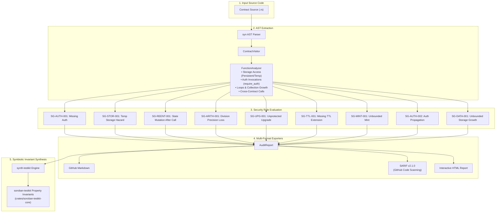

# Soroban Guard

[](https://github.com/stellar-crucible/soroban-guard/actions/workflows/ci.yml)
[](https://github.com/stellar-crucible/soroban-guard/actions/workflows/security.yml)
[](https://stellar-crucible.github.io/soroban-guard/)
[](https://github.com/stellar-crucible/soroban-guard/releases/latest)
[](LICENSE)
[](https://www.rust-lang.org)

Static AST security auditing and testkit invariant synthesizer for [Soroban](https://developers.stellar.org/docs/smart-contracts) smart contracts on the Stellar network.

Part of the **Stellar Crucible** smart contract engineering triad:
- [**soroban-testkit**](https://github.com/stellar-crucible/soroban-testkit) — Unit test harnesses, property test strategies, and mock environments.
- [**soroban-guard**](https://github.com/stellar-crucible/soroban-guard) — Static AST security auditing and testkit invariant synthesizer.
- [**soroban-bench**](https://github.com/stellar-crucible/soroban-bench) — Macro-benchmarking, gas regression baselines, and storage rent simulations.

---

## Why Soroban Guard?

Smart contracts on Stellar (Soroban) run as compiled WebAssembly (WASM) inside a host-metered environment. While functional unit testing is essential, relying solely on runtime tests and compiled WASM audits leaves critical security vulnerabilities undiscovered:

1. **Opaque WASM Bytecode**: Once Rust contract code is compiled to WebAssembly, rich semantic information—type definitions, variable lifetimes, struct field visibility, and high-level authorization annotations like `require_auth()`—is stripped or obscured. Disassembling WASM cannot reliably reconstruct developer intent.
2. **Runtime Test Blind Spots**: Unit and property test suites only verify execution paths that test authors deliberately design. Critical vulnerabilities—such as missing caller authentication on administrative functions, unauthenticated contract upgrades, or arithmetic precision loss in token distributions—routinely pass standard tests unnoticed.
3. **Soroban-Specific Storage Hazards**: Soroban features three distinct storage tiers (**Persistent**, **Instance**, and **Temporary**) with active TTL (Time-To-Live) lifecycles. Storing financial balances in Temporary storage (which can silently vanish without archival restoration) or writing to Persistent storage without TTL renewal will lock or destroy contract state.
4. **Sub-second Feedback Loop**: Full WASM compilation and test suites take minutes. `soroban-guard` parses raw Rust Abstract Syntax Trees (AST) directly, providing near-instantaneous feedback (sub-second) directly inside developer IDEs and GitHub pull request CI gates before WASM binaries are ever produced.

---

## How It Works

Soroban Guard operates as a multi-stage static analysis and automated verification pipeline:



### Detailed Execution Stages

1. **AST Extraction (`syn`)**: Rust source files are parsed into strongly typed syntax trees via `syn`, identifying contract implementations marked with `#[contractimpl]` and struct configurations marked with `#[contracttype]`.
2. **Contextual Analysis (`ContractVisitor` & `FunctionAnalyzer`)**: The engine walks through every method body, recording:
   - State-modifying operations (storage `set`, `remove`, `extend_ttl`).
   - Authorization assertions (`require_auth`, `require_auth_for_args`).
   - Cross-contract calls (`invoke_contract`, client calls).
   - Control flow, branching, loops, and arithmetic operations (checking for division before multiplication).
3. **Rule Matching & Severity Scoring**: Discovered patterns are checked against specialized security rules (`SG-*`). Findings are assigned standardized severity ratings (**Critical**, **High**, **Warning**, **Info**) with file and line annotations.
4. **Multi-Format Export**: Findings are serialized into GitHub Markdown, SARIF v2.1.0 for automatic code scanning PR annotations, and standalone responsive HTML reports.
5. **Symbiotic Invariant Synthesis (`synth-testkit`)**: When a potential vulnerability is identified, `soroban-guard` synthesizes runnable `soroban-testkit` invariant regression tests to prove and guard against the issue in runtime test suites.

---

## Security Rules Catalogue

| Rule ID | Severity | Category | Target Hazard |
|---|---|---|---|
| `SG-AUTH-001` | **Critical** | Authorization | State-modifying function omitting `require_auth()` checks |
| `SG-STOR-001` | **High** | Storage Lifecycle | Using temporary storage for account balances or allowances |
| `SG-REENT-001` | **High** | Reentrancy | State mutation following external cross-contract call |
| `SG-ARITH-001` | **Warning** | Arithmetic | Division before multiplication or integer dust truncation |
| `SG-UPG-001` | **Critical** | Governance | Calling `update_current_contract_wasm` without administrator check |
| `SG-TTL-001` | **High** | State Archival | Persistent storage write lacking `extend_ttl` renewal |
| `SG-MINT-001` | **Critical** | Tokenomics | Minting routine lacking caller auth or total supply cap |
| `SG-AUTH-002` | **High** | Invocations | Cross-contract call missing sub-invocation authorization |
| `SG-DATA-001` | **High** | Resource Limits | Iterative storage writes inside loops or unbounded collection growth |

---

## Quickstart & CLI Usage

### Installation

```bash
cargo install --path crates/soroban-guard-cli
```

### Auditing Contracts

Scan a contract repository or specific directory:

```bash
soroban-guard check contracts/
```

Generate a GitHub Code Scanning compatible SARIF v2.1.0 file:

```bash
soroban-guard check contracts/ --format sarif > results.sarif
```

Generate an interactive single-page HTML report:

```bash
soroban-guard check contracts/ --format html > report.html
```

Filter by minimum severity:

```bash
soroban-guard check contracts/ --min-level high
```

---

## Symbiosis with `soroban-testkit`

Static analysis and property testing reinforce each other. When `soroban-guard` identifies a potential security vulnerability, it can automatically synthesize runnable `soroban-testkit` invariant regression tests:

```bash
soroban-guard synth-testkit contracts/ --output tests/security_invariants.rs
```

The generated file integrates directly with `soroban-testkit` test suites:

```rust
//! Auto-generated by soroban-guard synth-testkit
#[test]
fn test_deposit_unauthorized_fails() {
    let env = Env::default();
    let client = VaultContractClient::new(&env, &contract_id);
    let attacker = Address::generate(&env);

    // Tested via soroban-testkit assertion
    let res = client.try_deposit(&attacker, &1_000);
    assert!(res.is_err());
}
```

---

## GitHub Actions CI Integration

Add `soroban-guard` to your repository workflow for automatic pull request security gating:

```yaml
name: Security Audit

on:
  pull_request:
    branches: [main]

jobs:
  audit:
    runs-on: ubuntu-latest
    steps:
      - uses: actions/checkout@v4
      - uses: dtolnay/rust-toolchain@stable
      - name: Run Soroban Guard
        run: |
          cargo run -p soroban-guard-cli -- check contracts/ --format markdown > audit.md
          cat audit.md
```

---

## Contributing

Contributions are warmly welcomed! Please read [CONTRIBUTING.md](CONTRIBUTING.md) for local development instructions, test guidelines, and how to implement new rules.
